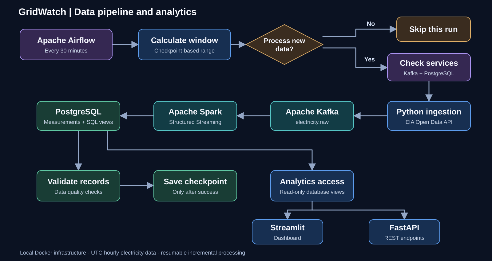
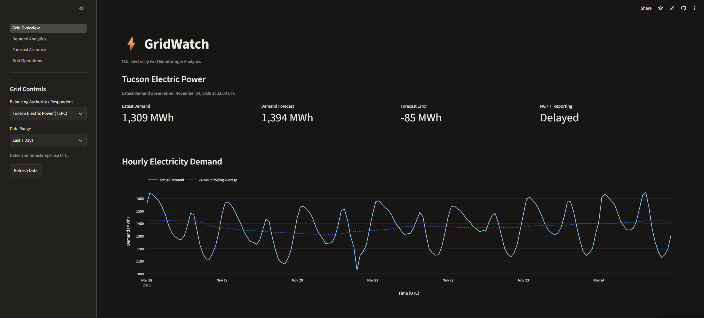
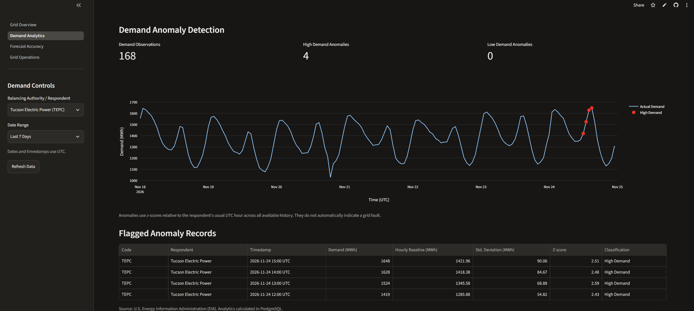
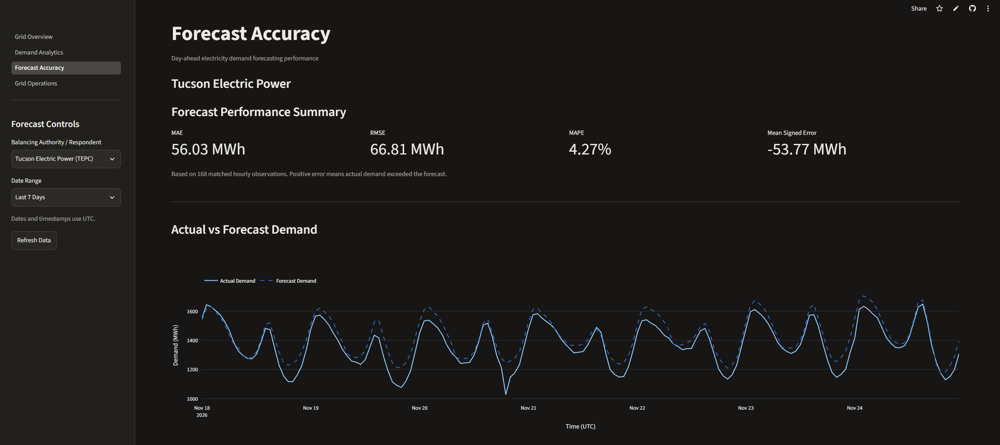
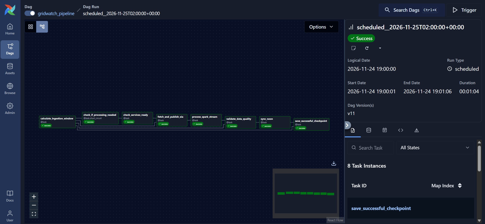
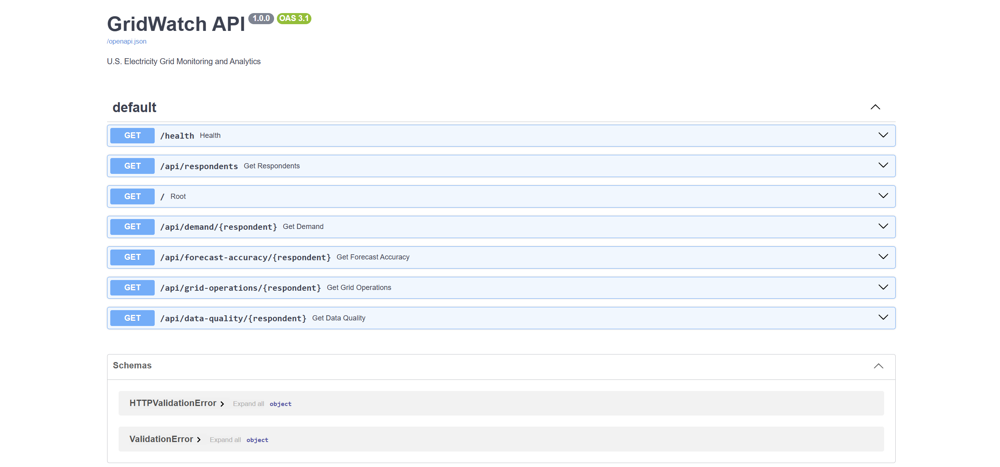

# GridWatch

**End-to-end data engineering for U.S. electricity grid analytics.**

[](https://github.com/viswakaruturi/gridwatch/actions/workflows/tests.yml)

GridWatch ingests hourly electricity data from the [U.S. Energy Information Administration (EIA)](https://www.eia.gov/opendata/), streams and processes it through Kafka and Spark, and serves analytics through an interactive dashboard and REST API. Airflow orchestrates incremental processing, recovery, data checks, and synchronization to a cloud PostgreSQL database.

**[Live Dashboard](https://gridwatch-energy-analytics.streamlit.app/)** | **[REST API / Swagger Docs](https://gridwatch-api-hk51.onrender.com/docs)** | **[API Health](https://gridwatch-api-hk51.onrender.com/health)**

## Architecture



The **processing pipeline runs locally** in Docker; validated data is synchronized to **Neon PostgreSQL** for the publicly hosted dashboard and API. Public services remain accessible when the local machine is off, but data updates depend on the local pipeline running.

## Screenshots

<details>
<summary>View the dashboard, Airflow pipeline, and API screenshots</summary>

### Grid Overview



### Demand Analytics



### Forecast Accuracy



### Airflow Orchestration



### REST API



</details>

## Tech Stack

| Layer                    | Technologies                      |
| ------------------------ | --------------------------------- |
| Ingestion & messaging    | Python, EIA API, Apache Kafka     |
| Stream processing        | Apache Spark Structured Streaming |
| Data storage & analytics | PostgreSQL, SQL views, Neon       |
| Orchestration            | Apache Airflow, Docker Compose    |
| Applications             | Streamlit, Plotly, FastAPI        |
| Testing & CI             | pytest, unittest, GitHub Actions  |

## What It Does

- **Incremental ingestion:** Collects demand (`D`), day-ahead forecasts (`DF`), net generation (`NG`), and interchange (`TI`) from EIA.
- **Reliable processing:** Kafka buffers events; Spark validates, deduplicates, and upserts records into PostgreSQL using `(period, respondent, type)` as the unique key.
- **Automated recovery:** Airflow checks every 30 minutes, retries failed tasks, resumes missed processing windows after downtime, and advances its checkpoint only after validation and Neon synchronization succeed.
- **SQL analytics:** 15 views for demand trends, peak events, anomalies, forecast accuracy (MAE/RMSE/MAPE), generation-demand balance, interchange, coverage, and freshness.
- **Interactive exploration:** Four Streamlit pages - Grid Overview, Demand Analytics, Forecast Accuracy, and Grid Operations - plus six read-only FastAPI endpoints.

**Data caveats:** EIA regional and balancing-authority series may overlap; missing generation/interchange readings are not zero. Freshness reflects the latest data in the database, and reported measurements may arrive with delays.

## API

Explore all endpoints and parameters in the **[interactive documentation](https://gridwatch-api-hk51.onrender.com/docs)**.

| Endpoint                                  | Returns                                    |
| ----------------------------------------- | ------------------------------------------ |
| `GET /health`                             | API and database health                    |
| `GET /api/respondents`                    | Available grid respondents                 |
| `GET /api/demand/{respondent}`            | Hourly demand; date filters and pagination |
| `GET /api/forecast-accuracy/{respondent}` | MAE, RMSE, MAPE, forecast bias             |
| `GET /api/grid-operations/{respondent}`   | Demand, generation, interchange, balance   |
| `GET /api/data-quality/{respondent}`      | Data freshness and daily coverage          |

Example: [`/api/demand/TEPC?limit=5`](https://gridwatch-api-hk51.onrender.com/api/demand/TEPC?limit=5)

## Run Locally

**Requirements:** Docker Desktop, Python, and an [EIA API key](https://www.eia.gov/opendata/register.php).

```powershell
# From the repository root
Copy-Item .env.example .env
python -m pip install -r requirements.txt
```

Fill in `.env` with your EIA key, PostgreSQL credentials, and a valid Kafka KRaft cluster ID. **Never commit `.env`.** On first setup, create the `electricity` table using `sql/schema.sql`, apply `sql/views/01_demand.sql` through `04_data_quality.sql` in order, and create the Kafka topic `electricity.raw` (3 partitions, replication factor 1).

```powershell
docker compose up -d
docker compose -f airflow/compose.yaml up -d --build

# Run these in separate terminals
python -m streamlit run dashboard/Grid_Overview.py
python -m uvicorn api.main:app --reload
```

- **Airflow:** http://localhost:8080 - enable `gridwatch_pipeline`.
- **Streamlit:** http://localhost:8501
- **FastAPI:** http://127.0.0.1:8000/docs

For cloud synchronization, set `NEON_DATABASE_URL` privately in `.env` and make it available to Airflow. Hosted apps use `GRIDWATCH_ENV=production`. The initial Neon database must contain the schema and SQL views before synchronization.

## Tests & CI

```powershell
python -m pytest tests/test_api.py -v
python -m unittest discover -s tests -p "test_recovery.py" -v
```

**13 local tests passed:** 11 database-backed API integration tests and 2 ingestion recovery tests. GitHub Actions checks Python syntax and runs recovery tests on pushes and pull requests to `main` (it does **not** run the database-backed API tests).

## Deployment Notes

- **Local:** Docker-hosted Kafka, Spark, PostgreSQL, and Airflow. Compute and ingestion pause when the laptop is off.
- **Cloud:** Neon hosts a synchronized PostgreSQL copy; Streamlit Community Cloud hosts the dashboard; Render hosts FastAPI. Render's free service may take longer to respond after inactivity.

**Source:** [EIA Open Data](https://www.eia.gov/opendata/).
